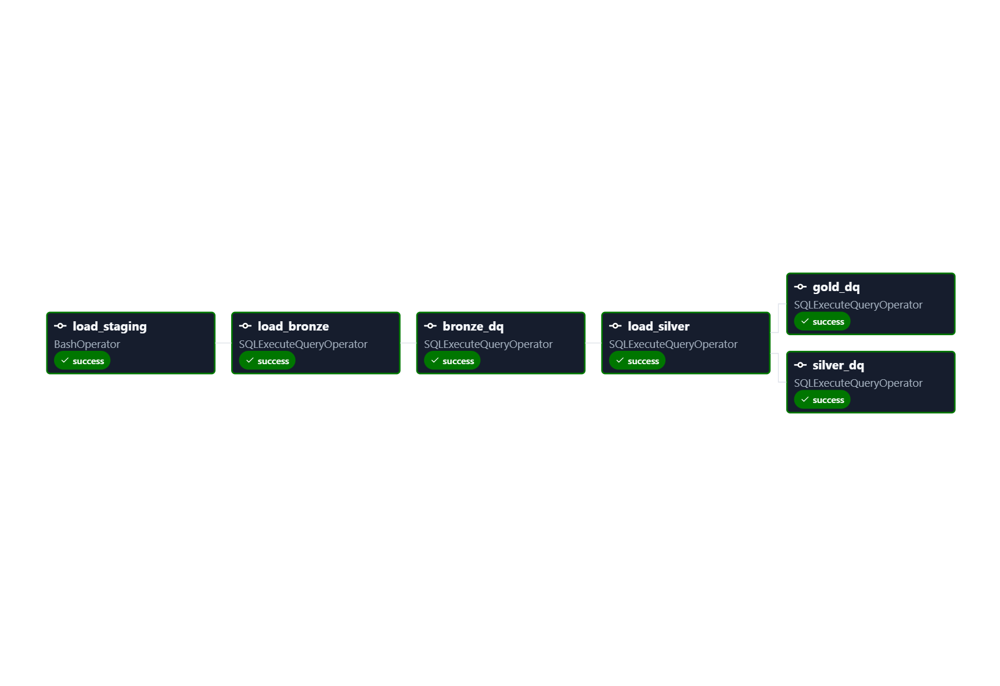

## Current Airflow Pipeline

The current DAG orchestrates the incremental weather data pipeline:

`load_incremental_batch -> load_bronze -> bronze_dq -> load_silver -> [silver_dq, gold_dq]`

```text
NOAA GHCN-Daily (Weather & Stations)
              |
              v
    load_incremental_batch
              |
              v
     Intermediate CSV batch
              |
              v
       Staging (PostgreSQL)
              |
              v
        load_bronze
              |
              v
         Bronze
              |
              v
        bronze_dq
              |
              v
        load_silver
              |
              v
          Silver
              |
        +-----+------+
        |            |
        v            v
    silver_dq     gold_dq
                     |
                     v
              Gold VIEW (read)
```

- `load_incremental_batch`
  - uses `BashOperator`
  - runs `/app/01_scripts/13_process_noaa_incremental_batch.py`
  - fetches the latest observation date from Bronze
  - downloads the current NOAA weather dataset and station metadata
  - filters weather observations newer than the current Bronze watermark
  - writes intermediate CSV files
  - loads the incremental batch into PostgreSQL Staging using `COPY`

- `load_bronze`
  - uses `SQLExecuteQueryOperator`
  - executes the PostgreSQL `load_bronze()` procedure
  - moves new records from Staging to Bronze

- `bronze_dq`
  - uses `SQLExecuteQueryOperator`
  - executes `01_bronze_dq.sql`
  - validates the Bronze layer before Silver processing begins

- `load_silver`
  - uses `SQLExecuteQueryOperator`
  - executes the PostgreSQL `load_silver()` procedure
  - transforms and loads new Bronze records into Silver

- `silver_dq` and `gold_dq`
  - use `SQLExecuteQueryOperator`
  - run automated data quality checks after the Silver load

Gold is implemented as a PostgreSQL VIEW, so it does not require a separate load task.



## Docker and Airflow environment

The Docker and Airflow environment was developed with AI assistance and manually tested during project development.

The project source code is mounted into the Airflow containers using:

`.:/app`

This makes the project files available inside Airflow, but mounted files do not include Python packages installed in other Docker containers.

For this reason, Airflow uses a custom image based on `apache/airflow:3.3.2` with the Python dependencies required by the pipeline installed separately.

In practice:

- Docker volumes provide access to project files.
- The Airflow image provides the Python runtime and required libraries.
- Airflow tasks execute pipeline scripts inside the Airflow environment.
- Containers connect to PostgreSQL internally using `db:5432`.
- Local tools such as VS Code and Jupyter access the same PostgreSQL container through `localhost:5434`.

## Staging/TRUNCATE

The incremental NOAA processing script truncates:

- `staging.stations`
- `staging.weather`

before loading the newly prepared source batch.

This is intentional because Staging represents only the current incoming batch.

Historical data is preserved in the Bronze and Silver layers. Incremental logic is applied when data moves from Staging to Bronze rather than by retaining previous batches in Staging.
